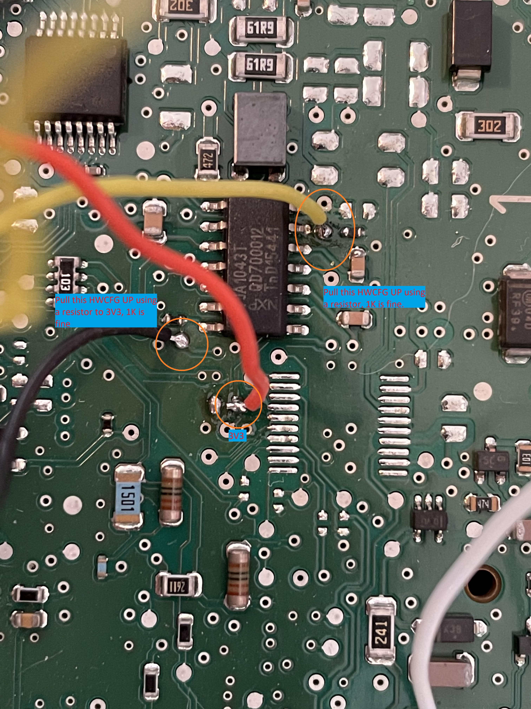
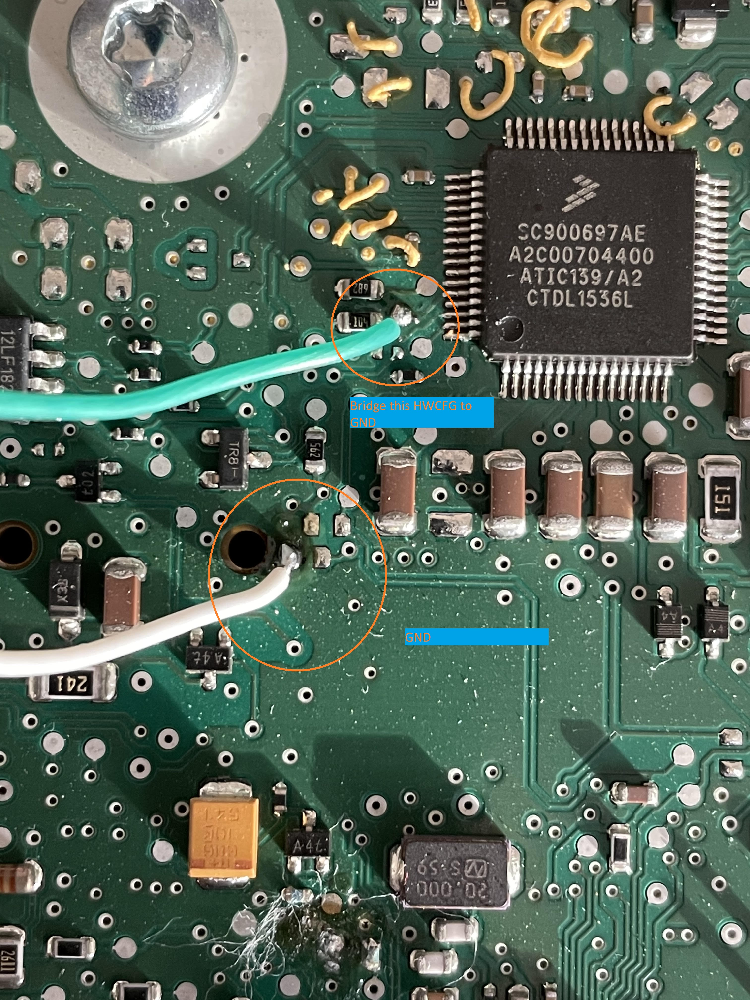
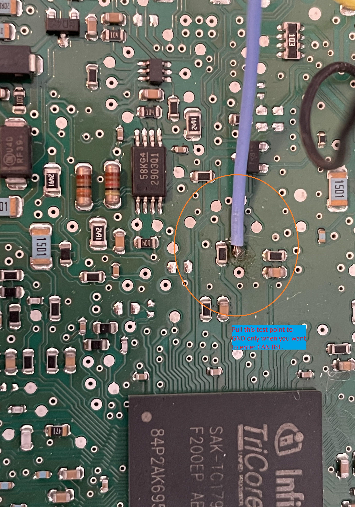
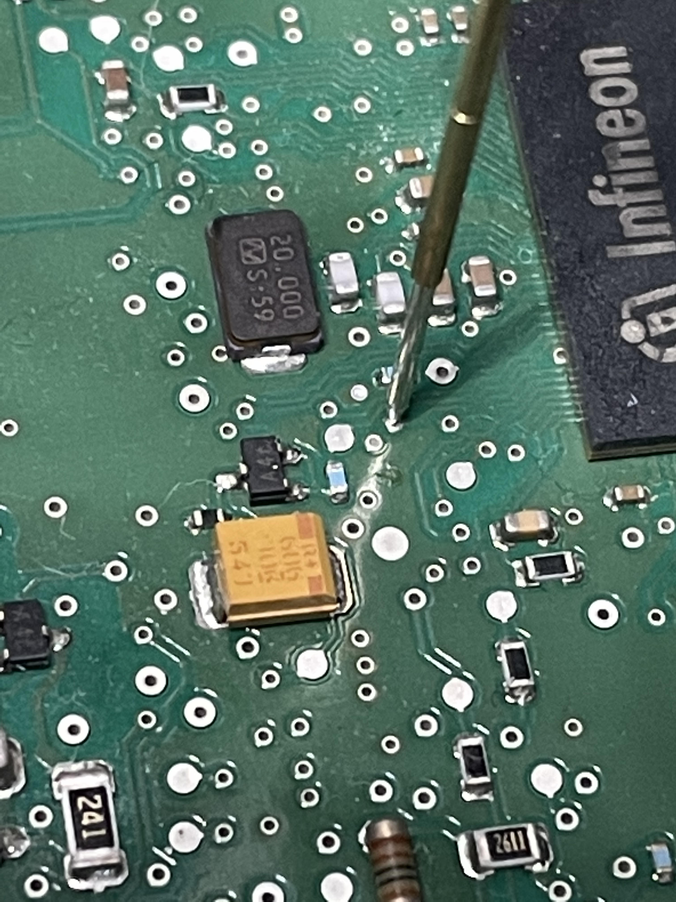
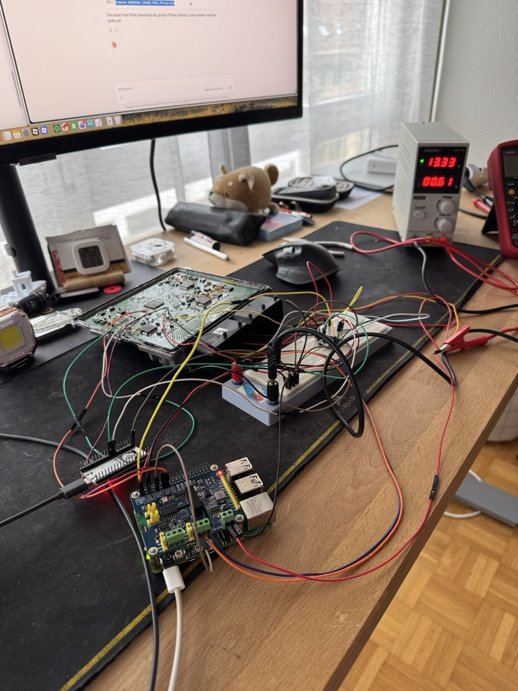

# Audi A3 8V 1.8 TFSI – Simos 12.1 → Simos 18.1 ECU Swap, Bench Read & Immo-Off Flash

## Raspberry Pi 5 + ESP32

---

## Background

Audi A3 8V, European market, EA888 Gen 3 1.8 TFSI, engine code CJSA. Original ECU is a Simos 12.1.

The Simos 18.1 has better tuning tool support, more boost control options, and a large community around patches and calibration. bri3d's open-source toolchain (TC1791_CAN_BSL, Simos18_SBOOT, VW_Flash) enables full bench read/write without commercial tools. The Simos 18.1 is a direct plug & play swap for the 12.1 on EA888 Gen 3 — same connector, same sensors, no wiring changes.

If you don't have access to ODIS Engineering, you need an immo-off patched binary since the replacement ECU is married to a different vehicle.

The following part numbers are listed in the VW_Flash update matrix for the 1.8T:
8V0906264A, 8V0906264D, 8V0906264F, 8V0906264K, 8V0906264L, 8V0906264M.
This guide was done with an 8V0906264D.

---

## Hardware

- Raspberry Pi 5
- Waveshare 2-CH CAN FD HAT
- ESP32 WROOM-32
- 3.3V ↔ 5V bidirectional level shifter
- 12V bench power supply (at 13.3V the ECU never drew more than 0.7A, so a small supply works)
- Simos 18.1 ECU

## ECU Internal Modifications

You have to open the ECU and solder a few connections. Refer to the images in [bri3d/TC1791_CAN_BSL](https://github.com/bri3d/TC1791_CAN_BSL):


**Board1.jpg:** Connect red → 1kΩ resistor → black + yellow.


**Board3.jpg:** Connect turquoise and white.


**Board2.jpg:** Wire directly to Pi GPIO 27.


**RST.jpg:** Wire directly to Pi GPIO 22.

3V3 for the level shifter LV side comes from the Pi's 3.3V pin.

The HWCFG pullup wires on the PCB can come loose — if you get no CAN response after reset, check your solder joints first.

## Wiring

| ECU Pin | Function | Connect to |
|---------|----------|------------|
| Pin 71 | GPT_1 (PWM Signal 1) | ESP32 GPIO 18 via level shifter |
| Pin 66 | GPT_2 (PWM Signal 2) | ESP32 GPIO 19 via level shifter |
| Pin 79 | CAN H | CAN HAT H |
| Pin 80 | CAN L | CAN HAT L |
| Pin 1 | GND | Pi GND + ESP32 GND + CAN HAT G pin |
| Pin 6/50/86 | 12V+ | Bench power supply |

ESP32 GND, Pi GND, CAN HAT G pin, ECU GND, level shifter GND, and 12V supply GND all need to be tied together. Missing CAN ground was a major issue during this build — without a shared ground reference, CAN communication drops out intermittently or completely.


Your desk may look like that.

---

## Raspberry Pi 5 Setup

Enable SPI via `sudo raspi-config`.

Add to `/boot/firmware/config.txt`:

```
dtparam=spi=on
dtoverlay=spi1-3cs
dtoverlay=mcp251xfd,spi0-0,interrupt=25
dtoverlay=mcp251xfd,spi1-0,interrupt=24
```

Reboot. Then bring up CAN:

```bash
sudo ip link set can0 up type can bitrate 500000
sudo ifconfig can0 txqueuelen 65536
```

Verify with `candump can0` (from `can-utils`) — you should see ECU traffic when the ECU is powered.

### Repositories

```bash
cd ~
git clone https://github.com/bri3d/TC1791_CAN_BSL
git clone https://github.com/bri3d/Simos18_SBOOT
git clone https://github.com/bri3d/VW_Flash
```

### Compile twister

```bash
cd ~/Simos18_SBOOT
gcc twister.c -o twister -O3 -march=native -fopenmp -lgmp
```

You may need to install `libgmp-dev` and `libgomp1` if they're not already present.

### Python Environment

```bash
cd ~/TC1791_CAN_BSL
uv pip install python-can tqdm udsoncan==1.21 "can-isotp<2.0" lz4
```

`can-isotp` must be below 2.0. Version 2.x changed the socket API and breaks both TC1791_CAN_BSL and VW_Flash.

### VW_Flash

```bash
cd ~/VW_Flash

# Remove wxPython from dependencies — it's only for the GUI and takes forever to build on ARM
sed -i '/wxpython/Id' pyproject.toml requirements.txt 2>/dev/null

# Compile LZSS
cd lib/lzss
gcc -O2 -o lzss lzss.c
cd ../..

uv pip install -r requirements.txt
uv pip install "can-isotp<2.0"
```

---

## ESP32 PWM Generator

The Pi 5 uses the RP1 chip for GPIO. `pigpio` (the DMA-based timing library used in bri3d's original scripts) does not work on the Pi 5. Software PWM has too much jitter for reliable SBOOT entry. The ESP32 has dedicated hardware timers and provides jitter-free PWM at 3.2kHz.

The Tricore GPTA comparator measures two signals:
- Signal 1 (ECU Pin 71): 3.2kHz, 50% duty cycle
- Signal 2 (ECU Pin 66): 3.2kHz, 25% duty cycle, 270° phase offset

### Arduino Sketch

Flash to ESP32 via Arduino IDE. Board: ESP32 Dev Module.

```cpp
#include "soc/gpio_struct.h"
#include "driver/gpio.h"
#include "esp_timer.h"

#define PIN_SIG1  18  // 50% duty → ECU Pin 71
#define PIN_SIG2  19  // 25% duty → ECU Pin 66

// 3200 Hz = 312.5µs period
// t=0:     Sig1=HIGH, Sig2=LOW
// t=156:   Sig1=LOW
// t=234:   Sig2=HIGH
// t=312:   Sig2=LOW → next cycle

void pwmTask(void *param) {
  gpio_set_direction((gpio_num_t)PIN_SIG1, GPIO_MODE_OUTPUT);
  gpio_set_direction((gpio_num_t)PIN_SIG2, GPIO_MODE_OUTPUT);

  int64_t cycle_start;

  while(1) {
    cycle_start = esp_timer_get_time();

    GPIO.out_w1ts = (1 << PIN_SIG1);
    GPIO.out_w1tc = (1 << PIN_SIG2);

    while(esp_timer_get_time() - cycle_start < 156);
    GPIO.out_w1tc = (1 << PIN_SIG1);

    while(esp_timer_get_time() - cycle_start < 234);
    GPIO.out_w1ts = (1 << PIN_SIG2);

    while(esp_timer_get_time() - cycle_start < 312);
  }
}

void setup() {
  Serial.begin(115200);
  xTaskCreatePinnedToCore(pwmTask, "PWM", 2048, NULL, configMAX_PRIORITIES - 1, NULL, 1);
  Serial.println("PWM 3200Hz running on Core 1");
}

void loop() {
  delay(1000);
}
```

### Verify

Measure DC voltage with a multimeter (Hz mode won't work at 3.2kHz on cheap meters):
- GPIO 18: ~1.65V (50% of 3.3V)
- GPIO 19: ~0.825V (25% of 3.3V)

The ESP32 runs PWM continuously once powered via USB. No communication with the Pi needed.

---

## bootloader.py Changes for Pi 5

Since `pigpio` doesn't work on the Pi 5, the GPIO control in `bootloader.py` needs to be adapted. The PWM generation is handled entirely by the ESP32, so the Pi only needs to control the reset and HWCFG pins.

Pin assignments differ from the original because of CAN HAT conflicts:
- Reset: GPIO **22** (original was 23)
- BOOT_CFG: GPIO **27** (original was 24)

The `sboot_pwm()` function should do nothing since the ESP32 handles PWM:

```python
def sboot_pwm():
    print("PWM handled by ESP32 (external)")
    return type('', (), {'cancel': lambda self: None})()
```

Set `CRC_DELAY = 0.001` — the Pi 5 is faster than the Pi 3B+ and the default 0.0005 is too short. If the CRC value comes back as 0x0, the delay is too small. If the CRC address jumps multiple iterations past the target, the delay is too large. You want exactly one iteration (start_address + 0x100).

---

## Extract Boot Passwords

```bash
cd ~/TC1791_CAN_BSL
uv run bootloader.py
```

```
(BSL) extract_boot_passwords
```

This enters SBOOT 4 times via PWM break-in, cracks the Seed/Key each time, captures CRC values, and calculates boot passwords.

Each round should show:
```
CRC Address Reached:
0x8001430c          ← start + 0x100, exactly one iteration
CRC32 Current Value:
0xa980571e          ← not 0x0
```

Final output:
```
39a9485b5b3f95b5d6419bd3ddc97f92
```

First 16 hex chars = Read passwords: `39a9485b 5b3f95b5`
Last 16 hex chars = Write passwords: `d6419bd3 ddc97f92`

These are permanent, burned into OTP during manufacturing.

---

## Bench Read

```
(BSL) upload
(BSL) send_read_passwords 39a9485b 5b3f95b5
(BSL) flashinfo
```

Check that "Flash Locked Error" shows DISABLED. If still ENABLED, your CRC_DELAY may be wrong.

```
(BSL) dumpmem AF000000 18000 PMU0_DFlash.bin
(BSL) dumpmem AF080000 18000 PMU1_DFlash.bin
(BSL) dumpmem 80000000 200000 PMU0_PFlash.bin
(BSL) dumpmem 80800000 100000 PMU1_PFlash.bin
```

Back these up.

---

## Flash Immo-Off Binary

### Erase ASW3 and Reset into CBOOT

This bypasses the immobilizer and gets the ECU into a state where VW_Flash can communicate via UDS.

```
(BSL) upload
(BSL) send_write_passwords d6419bd3 ddc97f92
(BSL) erase_sector 80800000
(BSL) reset
```

The ECU will now boot into CBOOT since ASW3 is erased and the application software can't start. Disconnect the BSL wires (RST, HWCFG). Leave only CAN H/L/G + 12V connected.

### Unlock with FRF

```bash
cd ~/VW_Flash
uv run VW_Flash.py --action flash_unlock --frf FL_8V0906259H__0001.frf
```

### Flash

```bash
uv run VW_Flash.py --action flash_bin \
  --input_bin ./8V0906264H__0003_immo_off.bin \
  --patch_cboot
```

`--patch_cboot` patches the Customer Bootloader to accept modified software blocks.

### Verify

```bash
uv run VW_Flash.py --action get_ecu_info
```

You should see your part number, software version, and `State Of Flash Memory: 00`.

---

## VIN

The ECU will have the donor vehicle's VIN. This causes a gateway DTC for VIN mismatch and is TÜV-relevant.

The VIN is stored in encrypted DFlash — you can't hex-edit it.
The VIN mismatch doesn't prevent the engine from starting with immo-off.

---

## Troubleshooting

**No CAN traffic:** Check 12V, CAN H/L, and especially the CAN ground (HAT G pin to ECU). Run `candump can0`. If `ip link show can0` shows `state DOWN`, restart CAN.

**None responses after reset:** Loose HWCFG pullup wire on the ECU PCB. Resolder.

**FAILURE / 0x0A7 messages (ECU boots normally):** PWM signals not reaching the ECU. This is what the ESP32 solves — Pi 5 software PWM doesn't cut it. Also try swapping the Pin 66/71 connections.

**CRC Value = 0x0:** `CRC_DELAY` too small. Increase it.

**CRC Address too high:** `CRC_DELAY` too large. Decrease it.

**`socket.bind() got an unexpected keyword argument 'rxid'`:** Wrong can-isotp version. `uv pip install "can-isotp<2.0"`.

---

## Credits

- [bri3d](https://github.com/bri3d) — TC1791_CAN_BSL, Simos18_SBOOT, VW_Flash
- [resilar/crchack](https://github.com/resilar/crchack) — CRC reversal
